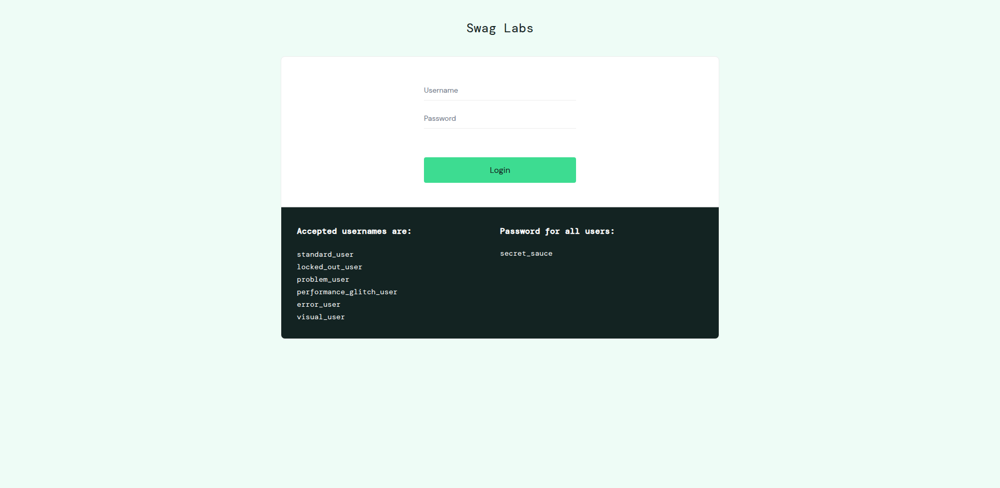
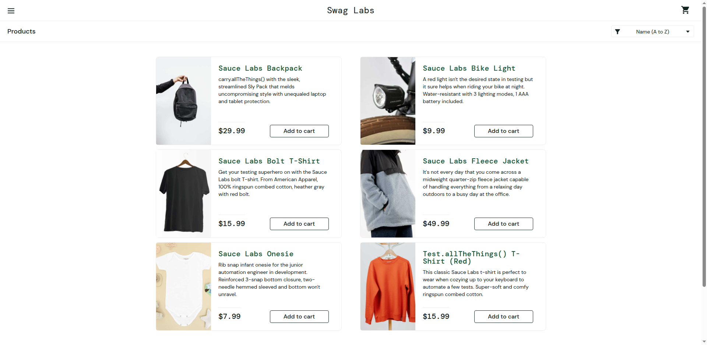
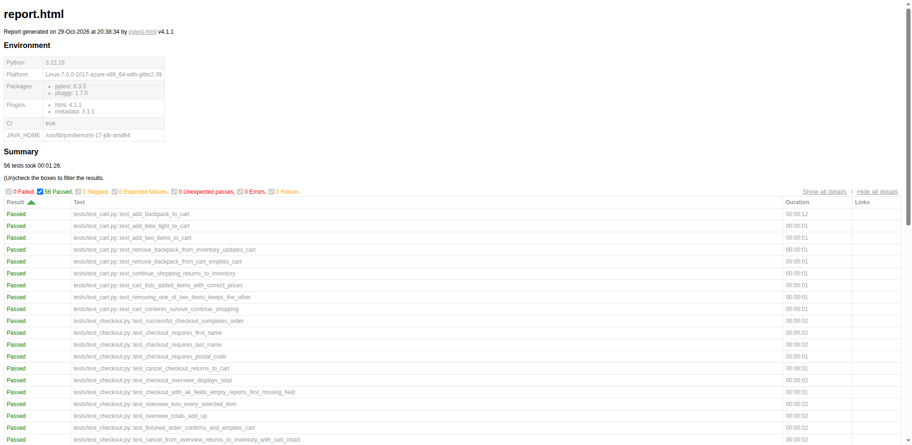

# SauceDemo Selenium + Python + pytest

[](https://github.com/vaishnavi-kalmegh/saucedemo-selenium-automation-portfolio/actions/workflows/tests.yml)

A portfolio-ready UI automation framework for [SauceDemo](https://www.saucedemo.com/) using **Python, Selenium WebDriver, pytest, and the Page Object Model (POM)**.

The project demonstrates maintainable test design, explicit waits, reusable fixtures, failure screenshots, self-contained HTML reporting, and GitHub Actions CI.

## What is covered

The suite is organized into five areas. Counts are the number of collected test cases (`pytest --collect-only`, parametrized cases included); the CI badge above shows the status of the latest run.

| Area | Marker | Tests | Coverage |
| --- | --- | ---: | --- |
| Login | `login` | 12 | Valid login, invalid credentials, required fields, locked-out user, every accepted demo user type, dismissing the error banner |
| Cart | `cart` | 9 | Add one/two products, remove products, cart contents and prices, removing one of two items, cart state across navigation |
| Checkout | `checkout` | 11 | Successful order, required-field validation, cancel from both steps, multi-item overview, tax and total arithmetic, order confirmation and empty cart afterwards |
| Inventory and product details | `inventory` | 18 | Product list and prices, all four sort orders, cart badge counts, product detail page for every product, add to cart from the detail page |
| Session | `session` | 6 | Logout, access to protected pages after logout and as an anonymous visitor, reset app state |

Every test carries exactly one of these markers, and `--strict-markers` is enabled so a mistyped marker fails loudly.

Expected values for the public demo store (product names, prices, the 8% tax rate, demo accounts) are kept in `data/` rather than scattered through the tests. Sorting tests compare the live page against Python's own sort of what is displayed, so they do not depend on a hard-coded order.

## Framework structure

```text
saucedemo-selenium-automation-portfolio/
├── .github/
│   └── workflows/
│       └── tests.yml
├── docs/
│   └── images/                         # Real Selenium evidence screenshots
│       ├── login-page.png
│       ├── inventory-page.png
│       └── pytest-report.png
├── data/                               # Expected values for the demo store
│   ├── catalog.py                      # Products, prices, tax rate, sort options
│   └── users.py                        # Public demo accounts
├── pages/
│   ├── base_page.py
│   ├── login_page.py
│   ├── inventory_page.py
│   ├── product_detail_page.py
│   ├── cart_page.py
│   ├── checkout_page.py
│   └── menu_page.py                    # Burger menu: logout, reset app state
├── reports/
│   └── screenshots/                    # Failure screenshots; git-ignored
├── scripts/
│   └── capture_portfolio_screenshots.py
├── tests/
│   ├── test_login.py
│   ├── test_inventory.py
│   ├── test_product_details.py
│   ├── test_cart.py
│   ├── test_checkout.py
│   └── test_session.py
├── conftest.py
├── pytest.ini
├── requirements.txt
└── README.md
```

### Page Object Model

- Locators and Selenium interactions live in pages/.
- Tests contain business flows and assertions, not raw Selenium locators.
- BasePage centralizes explicit wait helpers.
- conftest.py provides reusable browser, credentials, login, and checkout fixtures, including a `start_checkout` factory that adds any products and opens checkout.

### Synchronization

The framework uses WebDriverWait with Selenium expected conditions. There is **no time.sleep()**.

### Credentials

The public SauceDemo demo credentials are used by default:

- Username: standard_user
- Password: secret_sauce

They are overridable without changing source code:

~~~
SAUCE_USERNAME=your_user
SAUCE_PASSWORD=your_password
BASE_URL=https://www.saucedemo.com/
HEADLESS=true
~~~

On Windows PowerShell:

~~~
$env:SAUCE_USERNAME="your_user"
$env:SAUCE_PASSWORD="your_password"
$env:HEADLESS="true"
~~~

## Installation

Prerequisites:

- Python 3.12 recommended
- Google Chrome
- Git

Create and activate a virtual environment:

### Windows

~~~
python -m venv .venv
.venv\Scripts\activate
~~~

### macOS/Linux

~~~
python3 -m venv .venv
source .venv/bin/activate
~~~

Install the pinned dependencies:

~~~
python -m pip install --upgrade pip
pip install -r requirements.txt
~~~

## Run the tests

The default configuration is headless Chrome:

~~~
pytest
~~~

Run a headed browser by overriding the environment variable:

~~~
HEADLESS=false pytest
~~~

Run a specific suite:

~~~
pytest -m login
pytest -m cart
pytest -m checkout
pytest -m inventory
pytest -m session
~~~

Run a single test or a subset by name:

~~~
pytest -k "sort_orders_products"
pytest tests/test_checkout.py::test_overview_totals_add_up
~~~

Run Firefox:

~~~
pytest --browser=firefox
~~~

The default pytest configuration creates a self-contained report at:

~~~
reports/report.html
~~~

## Failure evidence

When a test fails, pytest captures a screenshot under:

~~~
reports/screenshots/
~~~

Those screenshots are attached to the pytest HTML report and are ignored by Git so local/CI failure artifacts do not clutter the repository.

## Screenshots

These images are captured from real Selenium runs; they are not mockups.

### SauceDemo login page



### SauceDemo inventory page



### Pytest HTML report



## CI/CD

GitHub Actions runs the full suite on:

- every push to main
- pull requests targeting main
- manual workflow_dispatch

The workflow uses **Python 3.12**, pip dependency caching, headless Chrome, and the pinned requirements file. Test reports and failure screenshots are uploaded as workflow artifacts.

After a successful main-branch run, the workflow captures the portfolio screenshots with Selenium and commits updated images under docs/images/.

## Portfolio highlights

This project demonstrates:

- Page Object Model design
- Login, inventory, product detail, cart, checkout, and session UI coverage
- Data-driven tests with `pytest.mark.parametrize`
- Business-rule assertions (tax and total arithmetic, sort order, access control)
- Explicit Selenium waits
- pytest fixtures and markers
- Environment-overridable credentials
- Headless CI execution
- Self-contained HTML reporting
- Automated failure screenshots
- Real browser evidence checked into the README
- GitHub Actions test automation

